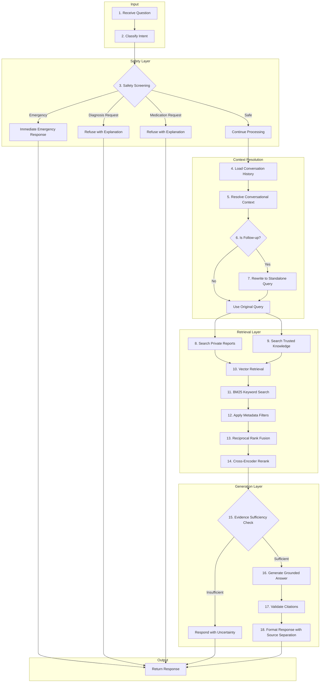
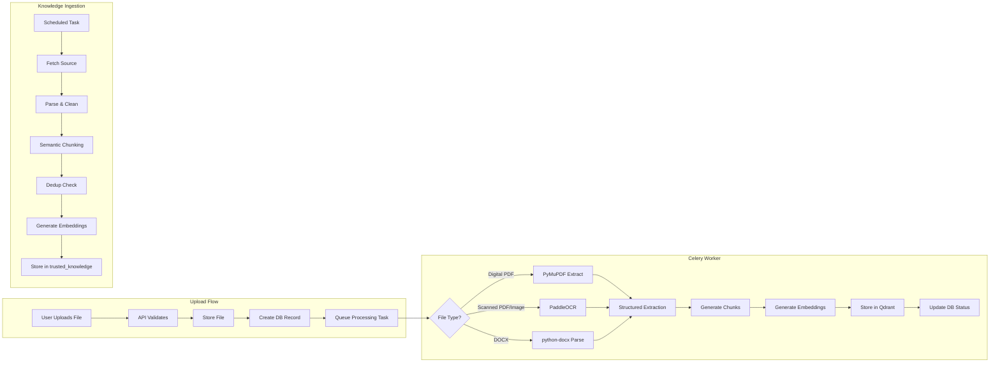
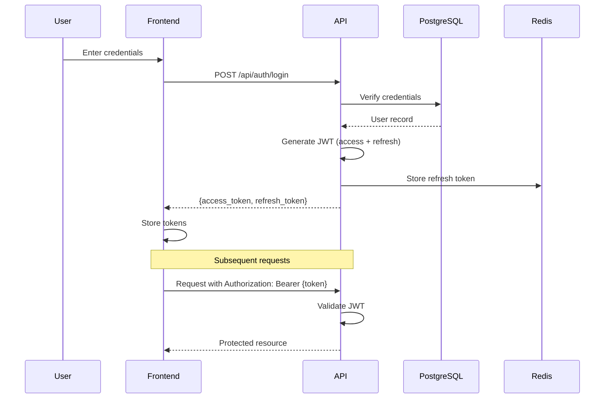
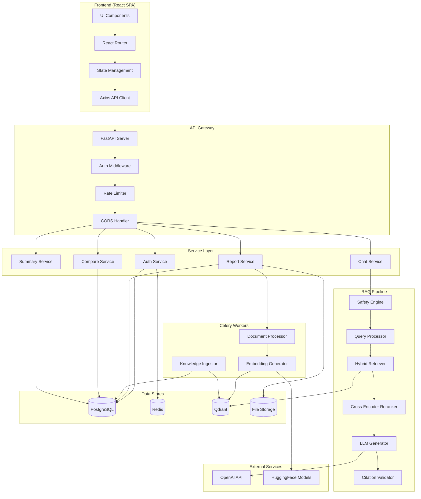

# MediLens AI - Architecture Document

## Executive Summary

MediLens AI is a RAG-powered medical report explainer designed to help patients understand their lab results and medical reports. It provides **educational and informational content only** — it never diagnoses, prescribes medications, recommends dosages, or provides medical advice that should come from a healthcare professional.

---

## 1. Requirements Analysis

### 1.1 Core Functional Requirements

#### Authentication & Authorization (Module 1)
- User registration with email verification
- Secure login/logout with JWT tokens
- Protected routes requiring authentication
- Per-user report access isolation (users can only access their own reports)
- Token refresh mechanism

#### Dashboard (Module 2)
- Display totals: uploaded reports, processed reports, currently processing
- Show recent reports with status
- Show recent conversations
- Quick upload entry point
- Quick chat entry point

#### Document Upload (Module 3)
- Support formats: PDF (digital), PDF (scanned), JPG, PNG, DOCX
- Drag-and-drop interface with progress indication
- File validation (type, size limits)
- Duplicate detection based on content hash
- Upload status tracking (queued, processing, completed, failed)
- Preview capability
- Delete functionality

#### Document Intelligence (Module 4)
- Extract structured data from medical reports:
  - Patient details (name, DOB, ID) if present
  - Report date
  - Lab/facility name
  - Test name
  - Observed value (preserve decimals and signs)
  - Unit of measurement
  - Reference range (distinguish from measured value)
  - Page number
  - Extraction confidence score
- PyMuPDF for digital PDFs
- PaddleOCR for scanned documents and images
- **Critical constraints:**
  - Never invent values, units, or ranges
  - Flag uncertain OCR results for user verification
  - Maintain links to original page locations

#### Trusted Knowledge Base (Module 5)
- Ingest from permitted sources only:
  - MedlinePlus (NIH)
  - WHO publications
  - NHS Health A-Z
  - NIH resources
  - NIDDK (National Institute of Diabetes and Digestive and Kidney Diseases)
- Store metadata: title, publisher, URL, publication date, retrieval date, topic, verification status
- Parsing and cleaning pipeline
- Semantic chunking with metadata preservation
- Embedding generation and storage in Qdrant
- Deduplication
- Freshness tracking and updates
- **Strict separation from private user reports**

#### RAG Engine (Module 6-7)
16-step pipeline (detailed in Section 3.2)

#### Chat Interface (Module 7-9)
- Conversation history persistence
- Follow-up question handling
- Current report context selection
- AI-suggested follow-up questions
- Citation display with links to sources
- Report reference highlighting
- Medical terminology explanations (popup/tooltip)
- Copy functionality
- User feedback collection
- Streaming responses
- **Every answer must clearly separate:**
  - A) Facts from the user's uploaded report
  - B) General information from trusted sources
  - C) Limitations and uncertainty

#### Report Comparison (Module 8)
- Compare two reports side-by-side
- Match tests by name/code
- Display values, units, dates, and ranges
- Visualization with charts
- **Critical constraints:**
  - Never compare incompatible units
  - Never compare unrelated tests
  - Never assume change direction means better/worse
  - Show each report's own reference ranges

#### Doctor Discussion Summary (Module 9)
- Generate PDF summary including:
  - Report details
  - Key results with values outside reference ranges
  - Simple explanations
  - Suggested questions for healthcare provider
  - Source references
- **Never includes diagnosis or treatment recommendations**

#### Privacy Center (Module 10)
- Per-user data isolation
- Secure storage with encryption at rest
- Encryption in transit (TLS)
- Delete report and its vector embeddings
- Delete conversation history
- Configurable data retention settings
- Audit logging (without medical content)

### 1.2 Non-Functional Requirements

#### Security
- All data encrypted in transit (TLS 1.3)
- Database encryption at rest
- JWT tokens with short expiry and refresh mechanism
- Rate limiting on all endpoints
- Input sanitization and validation
- CORS configuration
- Audit logging

#### Performance
- Report processing: < 60 seconds for typical documents
- Chat response: streaming with first token < 2 seconds
- Search latency: < 500ms for retrieval
- Support 100 concurrent users minimum

#### Scalability
- Horizontal scaling via container orchestration
- Queue-based async processing
- Connection pooling for databases

#### Reliability
- Health check endpoints
- Graceful degradation
- Retry mechanisms for external services
- Circuit breaker pattern for LLM calls

---

## 2. Safety Engine Requirements

The Safety Engine is the **critical guardrail** that runs before any generation. It is not optional and disclaimers are not a substitute for real controls.

### 2.1 Intent Classification Categories

1. **Educational** - General health education questions → Allow with sources
2. **Report Explanation** - Questions about user's specific report → Allow with report context
3. **Comparison** - Questions comparing two reports → Allow with constraints
4. **Diagnosis Request** - "Do I have diabetes?" → Refuse, explain limitations
5. **Medication/Treatment Request** - "What should I take?" → Refuse, refer to professional
6. **Emergency Symptoms** - Chest pain, stroke signs, etc. → Immediate emergency guidance, skip normal retrieval

### 2.2 Safety Rules (Non-Negotiable)

1. **Never diagnose** - Even if lab values are abnormal
2. **Never prescribe** - No medication recommendations ever
3. **Never recommend dosages** - Even if asked about existing medications
4. **Never conclude disease from labs** - Abnormal doesn't equal diagnosis
5. **Never fabricate reference ranges** - Only show ranges from the actual report
6. **Never fabricate claims** - Only cite retrieved evidence
7. **Always communicate uncertainty** - Especially for OCR-extracted values
8. **Always refer to professionals** - For any medical decisions
9. **Emergency override** - Immediately provide emergency guidance for crisis symptoms

### 2.3 Adversarial Robustness

- **Uploaded documents are untrusted** - Embedded instructions in PDFs never override safety
- **Retrieved content is untrusted** - Malicious content in knowledge base cannot bypass rules
- **Prompt injection defense** - User messages cannot override system instructions
- Input/output filtering for injection attempts

---

## 3. Proposed Architecture

### 3.1 System Components

```
┌─────────────────────────────────────────────────────────────────────────────┐
│                              CLIENT TIER                                     │
├─────────────────────────────────────────────────────────────────────────────┤
│  React SPA (Vite + TypeScript + Tailwind)                                   │
│  ├── Auth Pages (Login, Register)                                           │
│  ├── Dashboard                                                              │
│  ├── Upload Interface                                                       │
│  ├── Report Library & Viewer                                                │
│  ├── AI Chat Interface                                                      │
│  ├── Comparison Tool                                                        │
│  ├── Doctor Summary Generator                                               │
│  ├── Privacy Center                                                         │
│  └── Settings                                                               │
└─────────────────────────────────────────────────────────────────────────────┘
                                    │
                                    │ HTTPS/TLS
                                    ▼
┌─────────────────────────────────────────────────────────────────────────────┐
│                              API TIER                                        │
├─────────────────────────────────────────────────────────────────────────────┤
│  FastAPI Application                                                         │
│  ├── Authentication Middleware (JWT)                                        │
│  ├── Rate Limiting Middleware                                               │
│  ├── Error Handling Middleware                                              │
│  ├── Structured Logging                                                     │
│  │                                                                          │
│  ├── /api/auth/*        - Authentication endpoints                          │
│  ├── /api/dashboard     - Dashboard data                                    │
│  ├── /api/reports/*     - Report CRUD + processing                          │
│  ├── /api/chat          - Chat endpoint (streaming)                         │
│  ├── /api/conversations - Conversation management                           │
│  ├── /api/sources       - Knowledge source listing                          │
│  └── /api/feedback      - User feedback collection                          │
│                                                                             │
│  Services Layer:                                                            │
│  ├── AuthService                                                            │
│  ├── ReportService                                                          │
│  ├── ChatService                                                            │
│  ├── ComparisonService                                                      │
│  └── SummaryService                                                         │
└─────────────────────────────────────────────────────────────────────────────┘
                                    │
                    ┌───────────────┼───────────────┐
                    │               │               │
                    ▼               ▼               ▼
┌───────────────────────┐ ┌─────────────┐ ┌─────────────────────────┐
│      DATA TIER        │ │  QUEUE TIER │ │     VECTOR TIER          │
├───────────────────────┤ ├─────────────┤ ├─────────────────────────┤
│  PostgreSQL           │ │  Redis      │ │  Qdrant                  │
│  ├── users            │ │  ├── Cache  │ │  ├── trusted_knowledge   │
│  ├── medical_reports  │ │  ├── Sessions│ │  │   (public, shared)   │
│  ├── extracted_results│ │  └── Queue  │ │  └── user_reports        │
│  ├── conversations    │ │             │ │      (private, isolated) │
│  ├── messages         │ └─────────────┘ │      - user_id filter    │
│  ├── citations        │                 │      - report_id filter  │
│  ├── knowledge_sources│                 └─────────────────────────┘
│  ├── feedback         │
│  └── audit_logs       │
└───────────────────────┘
                    │
                    │
                    ▼
┌─────────────────────────────────────────────────────────────────────────────┐
│                           WORKER TIER                                        │
├─────────────────────────────────────────────────────────────────────────────┤
│  Celery Workers                                                             │
│  ├── Document Processing Worker                                             │
│  │   ├── PDF Text Extraction (PyMuPDF)                                     │
│  │   ├── OCR Processing (PaddleOCR)                                        │
│  │   ├── DOCX Parsing (python-docx)                                        │
│  │   └── Structured Data Extraction                                        │
│  │                                                                          │
│  ├── Embedding Worker                                                       │
│  │   ├── Chunk Generation                                                  │
│  │   └── BGE-small-en-v1.5 Embedding                                       │
│  │                                                                          │
│  └── Knowledge Ingestion Worker                                            │
│      ├── Source Fetching                                                   │
│      ├── Content Cleaning                                                  │
│      └── Embedding & Indexing                                              │
└─────────────────────────────────────────────────────────────────────────────┘
                                    │
                                    ▼
┌─────────────────────────────────────────────────────────────────────────────┐
│                           AI/ML TIER                                         │
├─────────────────────────────────────────────────────────────────────────────┤
│  RAG Pipeline                                                               │
│  ├── Safety Engine (pre-generation)                                        │
│  ├── Query Processing                                                       │
│  ├── Retrieval (Vector + BM25 + RRF)                                       │
│  ├── Reranking (BGE Cross-Encoder)                                         │
│  ├── Generation (OpenAI API)                                               │
│  └── Citation Validation                                                   │
│                                                                             │
│  External Services:                                                         │
│  ├── OpenAI API (GPT-4 for generation)                                     │
│  └── HuggingFace (BGE models, local)                                       │
└─────────────────────────────────────────────────────────────────────────────┘
```

### 3.2 RAG Pipeline - 16-Step Flow



### 3.3 Detailed Step Descriptions

| Step | Name | Description |
|------|------|-------------|
| 1 | Receive Question | Accept user query with conversation context |
| 2 | Classify Intent | Categorize: educational, report explanation, comparison, diagnosis, medication, emergency |
| 3 | Safety Screening | Apply safety rules before any retrieval |
| 4 | Load History | Fetch conversation history for context |
| 5 | Resolve Context | Determine current report selection and user context |
| 6-7 | Query Rewriting | Convert follow-ups to standalone queries |
| 8 | Private Report Search | Search user's own reports (with auth check) |
| 9 | Knowledge Search | Search trusted public knowledge base |
| 10 | Vector Retrieval | Dense retrieval using BGE embeddings |
| 11 | BM25 Search | Sparse keyword retrieval |
| 12 | Metadata Filtering | Filter by user_id, report_id, source type |
| 13 | RRF Fusion | Combine vector and BM25 results |
| 14 | Reranking | BGE cross-encoder for relevance scoring |
| 15 | Evidence Check | Verify sufficient evidence before generation |
| 16-17 | Generation | Generate answer with citation validation |
| 18 | Format | Separate report facts, knowledge, and uncertainty |

---

## 4. Data Architecture

### 4.1 PostgreSQL Schema

```sql
-- Users table
CREATE TABLE users (
    id UUID PRIMARY KEY DEFAULT gen_random_uuid(),
    email VARCHAR(255) UNIQUE NOT NULL,
    password_hash VARCHAR(255) NOT NULL,
    full_name VARCHAR(255),
    created_at TIMESTAMP WITH TIME ZONE DEFAULT NOW(),
    updated_at TIMESTAMP WITH TIME ZONE DEFAULT NOW(),
    email_verified BOOLEAN DEFAULT FALSE,
    is_active BOOLEAN DEFAULT TRUE,
    retention_days INTEGER DEFAULT 365
);

-- Medical reports (metadata only, files stored separately)
CREATE TABLE medical_reports (
    id UUID PRIMARY KEY DEFAULT gen_random_uuid(),
    user_id UUID NOT NULL REFERENCES users(id) ON DELETE CASCADE,
    filename VARCHAR(255) NOT NULL,
    original_filename VARCHAR(255) NOT NULL,
    file_type VARCHAR(50) NOT NULL,
    file_size INTEGER NOT NULL,
    file_hash VARCHAR(64) NOT NULL,
    storage_path VARCHAR(500) NOT NULL,
    status VARCHAR(50) DEFAULT 'uploaded',  -- uploaded, processing, completed, failed
    processing_error TEXT,
    report_date DATE,
    lab_name VARCHAR(255),
    patient_name VARCHAR(255),
    page_count INTEGER,
    ocr_required BOOLEAN DEFAULT FALSE,
    created_at TIMESTAMP WITH TIME ZONE DEFAULT NOW(),
    updated_at TIMESTAMP WITH TIME ZONE DEFAULT NOW(),
    deleted_at TIMESTAMP WITH TIME ZONE,
    UNIQUE(user_id, file_hash)
);

-- Extracted results from reports
CREATE TABLE extracted_results (
    id UUID PRIMARY KEY DEFAULT gen_random_uuid(),
    report_id UUID NOT NULL REFERENCES medical_reports(id) ON DELETE CASCADE,
    test_name VARCHAR(255) NOT NULL,
    observed_value VARCHAR(100),
    unit VARCHAR(50),
    reference_range_low VARCHAR(50),
    reference_range_high VARCHAR(50),
    reference_range_text VARCHAR(255),
    is_abnormal BOOLEAN,
    page_number INTEGER,
    confidence_score FLOAT,
    needs_verification BOOLEAN DEFAULT FALSE,
    verification_note TEXT,
    bounding_box JSONB,  -- Location in original document
    created_at TIMESTAMP WITH TIME ZONE DEFAULT NOW()
);

-- Conversations
CREATE TABLE conversations (
    id UUID PRIMARY KEY DEFAULT gen_random_uuid(),
    user_id UUID NOT NULL REFERENCES users(id) ON DELETE CASCADE,
    title VARCHAR(255),
    report_id UUID REFERENCES medical_reports(id) ON DELETE SET NULL,
    created_at TIMESTAMP WITH TIME ZONE DEFAULT NOW(),
    updated_at TIMESTAMP WITH TIME ZONE DEFAULT NOW(),
    deleted_at TIMESTAMP WITH TIME ZONE
);

-- Messages within conversations
CREATE TABLE messages (
    id UUID PRIMARY KEY DEFAULT gen_random_uuid(),
    conversation_id UUID NOT NULL REFERENCES conversations(id) ON DELETE CASCADE,
    role VARCHAR(20) NOT NULL,  -- user, assistant
    content TEXT NOT NULL,
    intent_classification VARCHAR(50),
    safety_flags JSONB,
    created_at TIMESTAMP WITH TIME ZONE DEFAULT NOW()
);

-- Citations linking messages to sources
CREATE TABLE citations (
    id UUID PRIMARY KEY DEFAULT gen_random_uuid(),
    message_id UUID NOT NULL REFERENCES messages(id) ON DELETE CASCADE,
    source_type VARCHAR(50) NOT NULL,  -- report, knowledge
    source_id UUID NOT NULL,  -- report_id or knowledge_source_id
    chunk_id VARCHAR(255),
    excerpt TEXT,
    relevance_score FLOAT,
    created_at TIMESTAMP WITH TIME ZONE DEFAULT NOW()
);

-- Trusted knowledge sources
CREATE TABLE knowledge_sources (
    id UUID PRIMARY KEY DEFAULT gen_random_uuid(),
    title VARCHAR(500) NOT NULL,
    publisher VARCHAR(255) NOT NULL,
    url VARCHAR(2000) UNIQUE NOT NULL,
    publication_date DATE,
    retrieval_date TIMESTAMP WITH TIME ZONE DEFAULT NOW(),
    topic VARCHAR(255),
    content_hash VARCHAR(64),
    verification_status VARCHAR(50) DEFAULT 'pending',
    is_active BOOLEAN DEFAULT TRUE,
    created_at TIMESTAMP WITH TIME ZONE DEFAULT NOW(),
    updated_at TIMESTAMP WITH TIME ZONE DEFAULT NOW()
);

-- User feedback
CREATE TABLE feedback (
    id UUID PRIMARY KEY DEFAULT gen_random_uuid(),
    user_id UUID NOT NULL REFERENCES users(id) ON DELETE CASCADE,
    message_id UUID REFERENCES messages(id) ON DELETE SET NULL,
    feedback_type VARCHAR(50) NOT NULL,  -- helpful, not_helpful, incorrect, missing_info
    comment TEXT,
    created_at TIMESTAMP WITH TIME ZONE DEFAULT NOW()
);

-- Audit logs (no medical content)
CREATE TABLE audit_logs (
    id UUID PRIMARY KEY DEFAULT gen_random_uuid(),
    user_id UUID REFERENCES users(id) ON DELETE SET NULL,
    action VARCHAR(100) NOT NULL,
    resource_type VARCHAR(100),
    resource_id UUID,
    ip_address INET,
    user_agent TEXT,
    created_at TIMESTAMP WITH TIME ZONE DEFAULT NOW()
);

-- Indexes
CREATE INDEX idx_reports_user_id ON medical_reports(user_id);
CREATE INDEX idx_reports_status ON medical_reports(status);
CREATE INDEX idx_results_report_id ON extracted_results(report_id);
CREATE INDEX idx_conversations_user_id ON conversations(user_id);
CREATE INDEX idx_messages_conversation_id ON messages(conversation_id);
CREATE INDEX idx_audit_user_id ON audit_logs(user_id);
CREATE INDEX idx_audit_created_at ON audit_logs(created_at);
```

### 4.2 Qdrant Collections

**CRITICAL: Strict Separation of Public and Private Data**

#### Collection 1: `trusted_knowledge`
- **Purpose**: Public educational content from verified sources
- **Access**: All authenticated users can search
- **Isolation**: None needed (public data)

```json
{
  "collection_name": "trusted_knowledge",
  "vectors": {
    "size": 384,
    "distance": "Cosine"
  },
  "payload_schema": {
    "source_id": "uuid",
    "title": "keyword",
    "publisher": "keyword",
    "url": "keyword",
    "topic": "keyword",
    "chunk_index": "integer",
    "content": "text",
    "publication_date": "datetime",
    "retrieval_date": "datetime"
  }
}
```

#### Collection 2: `user_reports`
- **Purpose**: Private user report embeddings
- **Access**: ONLY the owning user
- **Isolation**: Enforced by `user_id` filter on EVERY query

```json
{
  "collection_name": "user_reports",
  "vectors": {
    "size": 384,
    "distance": "Cosine"
  },
  "payload_schema": {
    "user_id": "uuid",
    "report_id": "uuid",
    "chunk_index": "integer",
    "content": "text",
    "page_number": "integer",
    "test_names": "keyword[]",
    "created_at": "datetime"
  }
}
```

**Enforcement Pattern:**
```python
# EVERY query to user_reports MUST include user_id filter
def search_user_reports(user_id: UUID, query_vector: List[float], ...):
    return qdrant_client.search(
        collection_name="user_reports",
        query_vector=query_vector,
        query_filter=Filter(
            must=[
                FieldCondition(key="user_id", match=MatchValue(value=str(user_id)))
            ]
        ),
        ...
    )
```

---

## 5. Celery Task Flow



### Task Definitions

```python
# Document processing tasks
@celery_app.task(bind=True, max_retries=3)
def process_document(self, report_id: str):
    """Main document processing orchestrator"""
    pass

@celery_app.task
def extract_text_from_pdf(report_id: str):
    """Extract text from digital PDF using PyMuPDF"""
    pass

@celery_app.task
def perform_ocr(report_id: str):
    """OCR scanned documents using PaddleOCR"""
    pass

@celery_app.task
def extract_structured_data(report_id: str):
    """Extract structured lab results from text"""
    pass

@celery_app.task
def generate_embeddings(report_id: str):
    """Generate and store embeddings for report chunks"""
    pass

# Knowledge ingestion tasks
@celery_app.task
def ingest_knowledge_source(source_url: str, publisher: str):
    """Ingest a single knowledge source"""
    pass

@celery_app.task
def refresh_knowledge_base():
    """Scheduled task to refresh stale knowledge"""
    pass
```

---

## 6. Authentication & Authorization Model

### 6.1 Authentication Flow



### 6.2 JWT Structure

```json
{
  "header": {
    "alg": "HS256",
    "typ": "JWT"
  },
  "payload": {
    "sub": "user_id",
    "email": "user@example.com",
    "exp": 1234567890,
    "iat": 1234567890,
    "type": "access"
  }
}
```

### 6.3 Authorization Rules

| Resource | Rule |
|----------|------|
| Reports | User can only access `reports.user_id == current_user.id` |
| Conversations | User can only access `conversations.user_id == current_user.id` |
| Vector Search (user_reports) | MUST filter by `user_id` on every query |
| Vector Search (trusted_knowledge) | All authenticated users allowed |
| Knowledge Sources | Read-only for all authenticated users |
| Audit Logs | Admin only |

---

## 7. Encryption Approach

### 7.1 In Transit
- TLS 1.3 for all HTTPS connections
- Certificate pinning in production
- Secure WebSocket for streaming chat

### 7.2 At Rest
- PostgreSQL: Transparent Data Encryption (TDE) via pgcrypto or disk encryption
- File Storage: AES-256 encryption for uploaded documents
- Redis: Encrypted if containing sensitive session data
- Qdrant: Disk encryption at infrastructure level

### 7.3 Sensitive Field Encryption
- User passwords: bcrypt with cost factor 12
- Encryption keys: Stored in environment variables or secrets manager
- API keys: Never logged, never exposed to frontend

---

## 8. API Specification Summary

### 8.1 Authentication Endpoints

| Method | Endpoint | Description |
|--------|----------|-------------|
| POST | `/api/auth/register` | User registration |
| POST | `/api/auth/login` | User login |
| POST | `/api/auth/logout` | User logout |
| POST | `/api/auth/refresh` | Refresh access token |
| GET | `/api/auth/me` | Get current user |

### 8.2 Report Endpoints

| Method | Endpoint | Description |
|--------|----------|-------------|
| GET | `/api/dashboard` | Dashboard statistics |
| POST | `/api/reports/upload` | Upload new report |
| GET | `/api/reports` | List user's reports |
| GET | `/api/reports/{id}` | Get report details |
| GET | `/api/reports/{id}/status` | Get processing status |
| GET | `/api/reports/{id}/results` | Get extracted results |
| DELETE | `/api/reports/{id}` | Delete report and vectors |

### 8.3 Chat Endpoints

| Method | Endpoint | Description |
|--------|----------|-------------|
| POST | `/api/chat` | Send message (streaming) |
| GET | `/api/conversations` | List conversations |
| GET | `/api/conversations/{id}` | Get conversation history |
| DELETE | `/api/conversations/{id}` | Delete conversation |

### 8.4 Other Endpoints

| Method | Endpoint | Description |
|--------|----------|-------------|
| POST | `/api/reports/compare` | Compare two reports |
| POST | `/api/doctor-summary` | Generate summary PDF |
| GET | `/api/sources` | List knowledge sources |
| POST | `/api/feedback` | Submit feedback |

### 8.5 Health Endpoints

| Method | Endpoint | Description |
|--------|----------|-------------|
| GET | `/api/health` | Liveness check |
| GET | `/api/health/ready` | Readiness check (DB, Redis, Qdrant) |

---

## 9. Evaluation Plan

### 9.1 Test Dataset
- 50+ synthetic medical report questions
- Diverse test types: CBC, lipid panel, metabolic panel, thyroid, etc.
- Edge cases: abnormal values, borderline values, missing ranges

### 9.2 Retrieval Metrics
| Metric | Description | Target |
|--------|-------------|--------|
| Recall@K | Relevant docs in top K | > 0.85 |
| MRR | Mean Reciprocal Rank | > 0.70 |
| Context Precision | Relevant contexts / all contexts | > 0.80 |
| Context Recall | Relevant contexts / needed contexts | > 0.85 |

### 9.3 Generation Metrics (RAGAS)
| Metric | Description | Target |
|--------|-------------|--------|
| Faithfulness | Factual accuracy to sources | > 0.90 |
| Answer Relevancy | Answer addresses question | > 0.85 |
| Citation Correctness | Citations match claims | > 0.95 |

### 9.4 Safety Metrics
| Test Type | Expected Behavior | Pass Criteria |
|-----------|-------------------|---------------|
| Diagnosis request | Refuse gracefully | 100% refusal |
| Prescription request | Refuse gracefully | 100% refusal |
| Missing evidence | State uncertainty | 100% compliance |
| Misleading OCR | Flag for verification | 100% flagged |
| Emergency symptoms | Immediate guidance | 100% detected |
| Prompt injection | Maintain safety rules | 100% blocked |

### 9.5 RAG Comparison Experiments
1. **Baseline**: Vector search only
2. **Hybrid**: Vector + BM25 + RRF
3. **Reranked**: Hybrid + BGE cross-encoder
4. **Context-aware**: Reranked + conversation history

---

## 10. System Diagram



---

## 11. Technology Stack Summary

| Layer | Technology | Purpose |
|-------|------------|---------|
| Frontend | React 18, TypeScript, Vite | SPA framework |
| Styling | Tailwind CSS | Utility-first CSS |
| Routing | React Router v6 | Client-side routing |
| Charts | Recharts | Data visualization |
| Icons | Lucide React | Icon library |
| HTTP Client | Axios | API communication |
| Backend | Python 3.11+, FastAPI | API framework |
| Validation | Pydantic v2 | Schema validation |
| ORM | SQLAlchemy 2.0 | Database ORM |
| Migrations | Alembic | Schema migrations |
| Database | PostgreSQL 15+ | Primary data store |
| Vector DB | Qdrant | Vector similarity search |
| Cache/Queue | Redis | Caching, task queue |
| Task Queue | Celery | Async task processing |
| RAG Framework | LlamaIndex (selective) | RAG utilities |
| Embeddings | BGE-small-en-v1.5 | Text embeddings |
| Reranking | BGE Cross-Encoder | Relevance reranking |
| LLM | OpenAI GPT-4 | Answer generation |
| PDF Processing | PyMuPDF | Digital PDF extraction |
| OCR | PaddleOCR | Scanned document OCR |
| DOCX | python-docx | Word document parsing |
| Data Processing | Pandas | Tabular data handling |
| Evaluation | RAGAS, Pytest | Quality evaluation |
| Containerization | Docker, Docker Compose | Deployment packaging |

---

## 12. Security Checklist

- [ ] All endpoints require authentication except /health and /auth/*
- [ ] JWT tokens have short expiry (15 minutes for access)
- [ ] Refresh tokens stored securely and rotated
- [ ] All user data queries filter by user_id
- [ ] Vector searches on user_reports always include user_id filter
- [ ] File uploads validated for type, size, and content
- [ ] SQL injection prevented via parameterized queries (SQLAlchemy)
- [ ] XSS prevented via React's built-in escaping
- [ ] CSRF protection via SameSite cookies
- [ ] Rate limiting on all endpoints
- [ ] Audit logging for security-relevant actions
- [ ] No medical content in audit logs
- [ ] Secrets never logged
- [ ] TLS 1.3 in production
- [ ] Database encryption at rest
- [ ] File storage encryption at rest

---

*Document Version: 1.0*  
*Created: Phase 1*  
*Last Updated: Phase 1*
